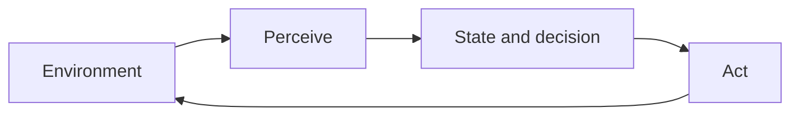

It is normal to find BDI, Reactive, ReAct, and Multi-Agent confusing at first. These terms come from different generations of research and engineering practice, and they answer different questions.

You do not need to memorize them first. We will use one example throughout: a **technical research agent** that searches for information, checks sources, and writes a report.

Imagine that it is answering, “What are Pi Agent's safety boundaries?” It needs to:

1. Read the question.
2. Decide where to search first.
3. Open sources and record its findings.
4. Decide whether the evidence is sufficient.
5. Continue searching or produce the report.

The previous two articles answered two foundational questions:

- [Chat, Workflow, or Agent?](/en/learn/agent-zero-to-one/chat-workflow-agent-guide/): who decides what happens next?
- [Agents Come in More Than One Form](/en/learn/agent-zero-to-one/agent-patterns-with-pi/): how much runtime decision-making authority does the model receive?

As you continue, you will encounter Reflex, Goal-based, BDI, Reactive, ReAct, and Multi-Agent. The easiest mistake is to arrange them into an upgrade path:

```text
Reactive → BDI → LLM Agent → Multi-Agent
```

That looks intuitive, but mixes different questions. It is like ranking “automatic transmission,” “electric car,” and “fleet” as successive grades of car: one describes control, another the power source, and another the number of vehicles.

If you remember one thing, make it this:

> **These terms are not upgrade levels. The same agent can belong to several of these categories at once.**

Start with four questions rather than the terminology:

| Question | In plain language | Terms you will encounter |
|---|---|---|
| What does it base its next action on? | The current situation, remembered history, a goal, or a comparison of outcomes? | Reflex, Goal-based, Utility-based |
| How does it organize decisions? | React immediately, plan first, or combine both? | Reactive, Deliberative, Hybrid, BDI |
| What makes the decisions? | Fixed rules, search algorithms, an LLM, or a combination? | Rules, Algorithms, LLM, Mixed |
| Is there one agent or more than one? | One worker, or a team with divided responsibilities? | Single Agent, Multi-Agent |

## Before classifying it, what does an agent actually do?

A robot vacuum, a trading program, and an LLM agent that calls tools all repeat the same basic loop:

- **Environment**: the external world the agent interacts with, such as websites, a code repository, or a user's question.
- **Perceive**: read new information from that environment.
- **State**: retain what is known and how far the task has progressed.
- **Decide**: choose the next action.
- **Act**: search, read a file, call an API, or return an answer.



Searching documentation is an action. Search results are new information from the environment. Reading those results and deciding whether to continue begins the next round of decisions.

[Artificial Intelligence: A Modern Approach](https://aima.cs.berkeley.edu/), usually abbreviated AIMA, defines an **agent function** as a function that selects an action based on the information perceived so far. Its companion open-source implementation is [aimacode/aima-python](https://github.com/aimacode/aima-python).

The book also uses the term **rational agent**. Rational does not mean extraordinarily intelligent. It means **choosing the action most likely to help achieve the goal, given the available information and constraints.**

Rationality does not imply omniscience or a guarantee of correct results. An agent can fail because information was missing and still have made a rational choice based on the evidence it had.

This loop is the common foundation for the classifications that follow.

## Question 1: What does it base its next action on?

AIMA commonly uses five teaching models to explain the basis for action. Start with what each would do in a research task:

| Intuition | Term | Research-agent example |
|---|---|---|
| Follow a rule when a condition appears | Simple Reflex | Switch to a backup URL after a 404 |
| Retain an internal account of the current world | Model-based | Remember which pages were read and which evidence is still missing |
| Choose an action that moves toward the goal | Goal-based | Look for a changelog to answer a version question |
| Compare the value of available choices | Utility-based | Balance source credibility, freshness, and cost |
| Change future behavior based on feedback | Learning | Adjust retrieval or ranking after repeatedly choosing poor sources |

**World state** means the agent's internal record of the current situation. A fact might no longer be visible on a webpage, but the agent still remembers reading it.

**Utility** is not a mysterious algorithm. It makes explicit which outcomes are more valuable. Official documentation may be authoritative while a community discussion is more recent; the agent needs to weigh those properties.

These are not five product editions or maturity levels that must be reached in order.

A technical research agent can be all of the following:

- Goal-based: it aims to answer a research question.
- Utility-based: it weighs freshness, credibility, and cost when choosing sources.
- Learning: it adjusts future retrieval strategies based on evaluation results.

One common misconception is that using a pretrained model automatically makes a system a learning agent. Here, learning means that the system changes its subsequent behavior in response to operational feedback, not merely that it contains a model trained in the past.

## Question 2: Does it react immediately or plan first?

The previous question concerned the basis for choosing actions. This question concerns how the entire decision process is organized. Research often calls this the **architecture** or **control architecture**.

### Reactive: respond directly

A reactive architecture responds to the current situation. It tries to let new information trigger behavior directly, with little state and a fast response.

For example, when a webpage is unavailable, the research agent immediately tries a backup URL. That local response does not require replanning the whole report.

Rodney Brooks's 1991 paper *Intelligence without representation* describes the influential **subsumption** approach. In plain language, simple behaviors are arranged in layers: urgent lower-level behavior can temporarily override a higher-level plan. A robot about to hit a wall can let “avoid the obstacle” override “keep moving forward.”

Two similar terms need separating here. Simple Reflex answers “What determines this action?” Reactive Architecture answers “How is the overall control process organized?” They often occur together, but describe different dimensions.

### Deliberative: reason and plan first

A deliberative agent maintains state, goals, or plans and reasons about which action to take.

The research agent might first plan “confirm the definition → check official documentation → look for counterexamples → write the conclusion.” This can support longer tasks, at the cost of more state management, search, and planning.

### Hybrid: combine the two

A hybrid architecture combines quick local responses with goal-directed planning for the overall task.

Production LLM agents often use a hybrid structure:

```text
Deterministic code: permissions, budgets, timeouts, approvals, database writes
LLM decisions: break down questions, select tools, adjust retrieval paths
```

Hybrid does not mean “calls several models.” It describes how control is organized into layers.

## What is BDI? Three notebooks for the agent

**BDI is not a fifth question. It is an internal organization model within Question 2.** Its name comes from Belief, Desire, and Intention.

Imagine three notebooks in front of the agent:

```text
Belief       What I currently believe to be true
Desire       Which goals I would like to achieve
Intention    What I have committed to pursuing now
```

For a research agent, these could be:

- **Belief**: the official documentation supports conclusion A, but version information is missing.
- **Desire**: find version evidence, finish the report, and keep API costs under control.
- **Intention**: check the changelog first, then decide whether to retain conclusion A.

Desire and Intention are easy to confuse. An agent may want many things at once, but commits to pursuing only some of them now. Intentions keep it from abandoning its direction every time a new clue appears.

BDI usually sits toward the deliberative side. Reactive rules can still surround it, forming a hybrid system.

Adding `beliefs`, `desires`, and `intentions` headings to a prompt does not by itself implement BDI. The system must also decide when those states change, which goal wins a conflict, and when an existing commitment should be abandoned.

## Question 3: Do rules, algorithms, or an LLM make decisions?

The same behavior—making a plan first—can use different mechanisms:

- Fixed code generates a plan from a template.
- A search algorithm finds a path among candidate plans.
- An LLM reads a natural-language goal and generates a plan.
- An LLM explores while deterministic code enforces permissions, budgets, and acceptance checks.

A **planner** is simply a component that produces plans. It is not necessarily an LLM, nor automatically an agent.

An LLM can:

- Interpret unstructured input.
- Generate or revise a plan.
- Choose tools and their arguments.
- Decide what to do next based on tool results.
- Turn the process into an answer people can read.

But one LLM call does not make an LLM agent. A call might only generate text. To work continuously as an agent, the system also needs environmental input, actions, and a loop that reads an action's result before deciding what to do next.

### ReAct: decide, act, observe, and decide again

**ReAct combines reasoning and acting.** It describes this loop:

```text
Decide what to do next → Take the action → Read the actual result → Decide again
```

For example, an LLM decides to read `package.json`. The tool returns the file. The LLM sees that it is a TypeScript project and decides to read `tsconfig.json` next.

ReAct and **Reactive Architecture** have similar spellings but different meanings:

```text
ReAct              An LLM alternates reasoning and action
Reactive Agent     A classical control architecture that responds quickly to current conditions
```

## Question 4: One agent or a team?

**Multi-Agent** does not describe how an individual agent thinks. It asks how many agents can choose actions relatively independently, and how they communicate, divide work, and coordinate.

Think of a research team. One researcher completing the task independently is a single agent. A lead assigning work to a source researcher, fact-checker, and report editor is a multi-agent arrangement.

**Topology** here means how that team is organized. Common arrangements include:

- **Single Agent**: one agent owns the goal and runs the loop.
- **Supervisor–Workers**: a supervisor divides the task among workers.
- **Peer**: agents with relatively equal roles exchange results.
- **Hierarchical**: several layers assign work and aggregate results.

Multi-agent systems are not automatically smarter. They add parallelism and specialization, but also communication, state synchronization, conflict resolution, cost, and acceptance complexity.

Likewise, several prompts, several model calls, or a pipeline in which a planner produces a plan and an executor follows it mechanically do not automatically constitute a multi-agent system. Check whether those units have relatively independent state, goals, actions, and coordination.

## Describe the same agent with all four questions

Return to the technical research agent. Before writing code, answer in ordinary language:

| Question | This research agent's answer |
|---|---|
| What determines its actions? | Completing the research goal while weighing source quality, freshness, and cost |
| How are decisions organized? | It plans the overall task and handles local errors quickly: hybrid control |
| What makes decisions? | The LLM explores; code enforces permissions, budgets, and acceptance checks |
| How many agents are there? | One in the first version, avoiding premature coordination costs |

In one line: **goals and source tradeoffs / hybrid control / LLM and code share decisions / single agent**.

Once that description makes sense, look at the TypeScript. This is not an industry standard; it is an architecture card for later lessons. `mentalModel` is optional because BDI can exist inside a hybrid system: the two are not mutually exclusive.

```ts
type ActionBasis =
  | "reflex"
  | "model-based"
  | "goal-based"
  | "utility-based"
  | "learning";

type ControlArchitecture =
  | "reactive"
  | "deliberative"
  | "hybrid";

interface ControlDesign {
  architecture: ControlArchitecture;
  mentalModel?: "bdi";
}

type DecisionMechanism =
  | "rules"
  | "algorithms"
  | "llm"
  | "mixed";

type TeamTopology =
  | "single"
  | "supervisor-workers"
  | "peer"
  | "hierarchical";

interface AgentArchitectureCard {
  actionBasis: ActionBasis[];
  control: ControlDesign;
  mechanism: DecisionMechanism;
  topology: TeamTopology;
}
```

The first version of our final project, an evidence-first technical research agent, has this profile:

```ts
const researchAgent: AgentArchitectureCard = {
  actionBasis: ["goal-based", "utility-based"],
  control: { architecture: "hybrid" },
  mechanism: "mixed",
  topology: "single",
};
```

It aims to answer a research question and weighs source quality against cost. The LLM explores; deterministic code handles permissions, budgets, and acceptance. The first version uses one agent to avoid introducing coordination costs too early.

Where does Pi fit? A **harness** hosts model calls, the loop that reads results and decides what happens next, tool execution, state, and runtime boundaries. Pi determines **how the agent runs**, not **which kind of agent it is**.

In the car analogy, Pi is closer to a chassis and test bench than to a power source or fleet organization. The same Pi runtime can support different tools, control boundaries, and organizational arrangements.

## Take four questions with you

When you encounter an agent system, do not start by asking which single category it belongs to. Ask:

1. What does it base actions on?
2. How is its internal decision process organized?
3. Do rules, algorithms, or an LLM make the main decisions?
4. How many independent agents are there, and how do they coordinate?

Having four sets of answers is normal, not a classification conflict.

The next stage examines the LLM runtime: first one model call, then messages, context, streaming, state, and stop conditions. Once those mechanisms are clear, we can implement ReAct, Plan-and-Execute, Reflection, and multi-agent systems without merely memorizing architecture names and missing what changes in the code.

## Quick glossary

| Term | One-sentence meaning |
|---|---|
| Reflex | Act directly on a rule triggered by the current situation |
| Goal-based | Choose actions that move toward a goal |
| Utility-based | Choose the more valuable outcome among feasible alternatives |
| Reactive | Organize control around quick responses to current conditions |
| Deliberative | Maintain state and plans before choosing an action |
| Hybrid | Combine quick reactions with longer-term planning |
| BDI | Organize internal state into beliefs, desires, and current commitments |
| ReAct | Alternate LLM reasoning, actions, and observations |
| Multi-Agent | Divide and coordinate work among relatively independent agents |
| Runtime | The models, state, tools, and control processes used while an agent runs |

## References

- Russell & Norvig, [Artificial Intelligence: A Modern Approach](https://aima.cs.berkeley.edu/), Chapter 2: agents, rationality, and classifications of action selection.
- Wooldridge & Jennings, [Intelligent Agents: Theory and Practice](https://doi.org/10.1017/S0269888900008122): classical agent theory, architectures, and languages.
- Brooks, [Intelligence without representation](https://doi.org/10.1016/0004-3702(91)90053-M): reactive architectures and subsumption.
- Rao & Georgeff, [BDI Agents: From Theory to Practice](https://cdn.aaai.org/ICMAS/1995/ICMAS95-042.pdf): beliefs, desires, intentions, and commitment mechanisms.
- Wooldridge, [An Introduction to MultiAgent Systems](https://www.cs.ox.ac.uk/people/michael.wooldridge/pubs/imas/IMAS2e.html): interaction and coordination in multi-agent systems.
- Yao et al., [ReAct: Synergizing Reasoning and Acting in Language Models](https://openreview.net/forum?id=WE_vluYUL-X): alternating reasoning and acting in LLMs.
- Anthropic, [Building Effective Agents](https://www.anthropic.com/engineering/building-effective-agents): workflows, agents, and modern engineering patterns.

The four-axis card, examples, and relationship diagram are teaching aids developed for this article, not translations or reproductions of figures from these sources.
