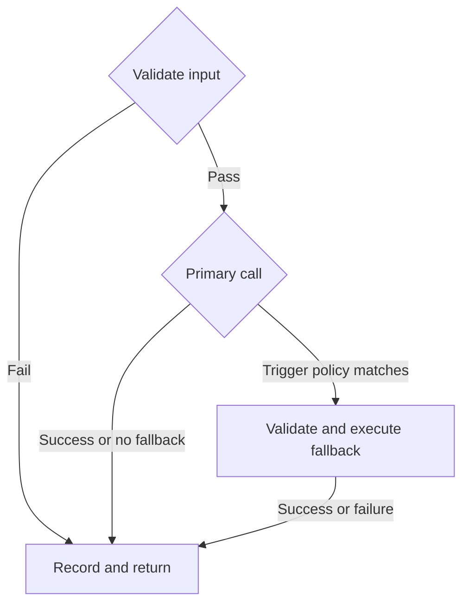

This is Part 3 of the PromptWeave series. Part 2 explained how a request selects a prompt and model. This article addresses a boundary that ad hoc fixes often undermine: **how should the system recover when the primary call fails?**

This remains an architectural design discussion, not a claim that the fallback capability is already deployed in production.

Suppose a mathematics request selects `Prompt A@v3 + Model A`, and the upstream model returns a retryable error. “Try another model” sounds straightforward, but leaves three questions unanswered: which prompt will it use, has that model's input format been validated, and does this combination belong to the current release?

Deciding those details at runtime might produce an answer, but it cannot establish that the fallback is an approved path.

## A fallback is more than another model name

The release should bind a complete fallback version:

```text
main:     Prompt A@v3 + Model A
fallback: Prompt A-backup@v2 + Model A-backup
```

The binding must include at least the fallback prompt revision, ModelConfig revision, and trigger policy. The policy defines which errors permit fallback, the maximum number of attempts, and whether switching is allowed after partial streaming output has already been delivered.

A fallback does not have to change the prompt. It does have to bind a specific prompt revision, ModelConfig, and trigger policy. The separate backup prompt above illustrates the most explicit form of that binding.

**When the primary call fails, execution may enter only a path permitted by the current release.** Providers, models, and prompts must not be silently substituted.

Record the logical request separately from its model attempts:

```text
runId
├── attempt 1: main Prompt A@v3 + Model A
└── attempt 2: fallback Prompt A-backup@v2 + Model A-backup
```

The caller sees one request. Under the same `runId`, the system retains two distinct attempts in their execution order. Reports can then answer both “What is this scenario's eventual success rate?” and “How many tokens did fallback attempts consume?”

## Validate before sending a model request

The prompt revision declares variables and input formats. The runtime checks required fields, types, empty values, and material formats before rendering the template. Variables use `{{name}}`; the renderer does not scan arbitrary `{...}` fragments, which could be JSON, LaTeX, or natural language.



Invalid input must reach neither the primary model call nor fallback. Otherwise, the fallback simply sends the same invalid input again.

## A runId makes failure explainable

Each execution should record at least:

- The ReleaseSnapshot, prompt revision, and ModelConfig revision used.
- The matched rule, bucket assignment, and routing decision.
- The trigger reason, error category, latency, and token usage of each attempt.
- The final outcome and whether it came from fallback.

The debug page calls the same execution engine, adding only `runType=debug`. Debug runs and real requests therefore share selection and validation logic, rather than taking different paths.

The purpose is to answer concrete questions: did the failure occur during selection, input validation, the primary call, or fallback? Did the configuration used belong to the published snapshot?

The next article follows this execution chain into test and production: **why must releases and rollbacks operate on complete snapshots instead of editing individual fields?**

Previous: [PromptCode, ModelConfig, and Routing](/en/learn/promptweave/promptweave-routing-boundaries/) · Next: [Release and Roll Back Complete Snapshots](/en/learn/promptweave/promptweave-release-snapshots/)
