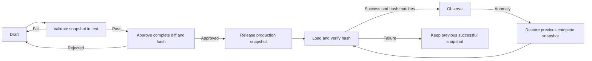

This is Part 4 of the PromptWeave series. The previous articles defined configuration ownership, request selection, and fallback. Now we put them into a delivery process: **how do we deploy the execution chain that was tested and restore it completely if something goes wrong?**

This is still an architectural design discussion, not a claim that these release capabilities are deployed in production. The scenario below tests the proposed release and rollback boundaries.

A problem-solving product is testing plans A and B, each receiving half the traffic. B performs better, so the team wants to end the experiment and route all traffic to B. But B includes a prompt revision, model settings, backup binding, and experiment rules. Merely changing the default prompt to B does not prove production will execute the complete plan that was tested.

## Create a new version instead of overwriting the old one

Ending the experiment must not mutate `r1`:

```text
r1: A@v3 50% / B@v2 50%
r2: default plan is B@v2; previous experiment rules are inactive
```

Overwriting `r1` loses the reliable record of traffic allocation and fallback relationships. Rollback would then require reconstructing the configuration. Creating `r2` keeps more history, but provides three guarantees:

- Later edits cannot change the tested version.
- The release diff can be reviewed explicitly.
- Rollback can select a known, complete version.

Prompt history should not be deleted either. When a prompt version is replaced through a new Scenario release, mark that prompt version `superseded`. Protected direct `promptCode` calls prevent it from becoming `archived`; they do not change its `superseded` status. Archival requires no active Scenario references, no protected direct calls, and expiration of the retention period. The archival task records checked references and reasons for skipping items. Historical versions are not deleted.

## Why a snapshot is the release unit

Test and production need isolated execution instances, credentials, caches, and request data. They should not maintain separate configuration sets that cannot be compared reliably. The configuration management database stores drafts, immutable revisions, approval records, and an independent release pointer for each environment:

```text
Configuration management database
├── Test pointer       → ReleaseSnapshot T
└── Production pointer → ReleaseSnapshot P

Test execution instances       Production execution instances
```

A `ReleaseSnapshot` pins at least:

- Prompt revisions.
- ModelConfig revisions.
- RouterRule revisions.
- Fallback chain revisions.
- A content hash and approval records.

Test and production can now be compared by complete snapshot and hash, rather than by fields that happen to look similar in two databases.

**Passing tests, receiving approval, and loading a snapshot are three separate states. Observation begins only after production instances have loaded the same snapshot that was approved.**

## Check each transition during release

1. **Validate in test.** Missing variables, unexpected primary-call failure, or unexpected fallback behavior sends the change back to the draft. A deliberately injected primary failure passes its recovery test when fallback behaves as specified.
2. **Approve the snapshot.** The release request includes the complete diff, reason, operator, and hash. Any content change after approval requires new approval.
3. **Verify loading.** Production instances report the hash they actually loaded. If loading fails, they retain the previous successfully loaded snapshot. A successful release command is not proof of successful deployment.
4. **Observe or restore.** Continue observing when metrics remain normal. On an anomaly, select the previous complete snapshot and verify which version new requests actually use.

In this example, rolling back to `r1` restores the complete 50/50 A/B plan. Restoring A-only traffic requires a different, previously validated snapshot. Hand-editing a few fields is not equivalent.

## How snapshots protect execution



A snapshot gives releases, execution, audits, and rollback the same reference point. A request's `runId` can lead back to its snapshot, scenario, prompt, model, routing decision, and every fallback attempt.

## Boundaries of this design

Phase 1 establishes reliable direct execution: prompt revisions, ModelConfig, constrained routing, one explicit fallback, environment snapshots, approval hashes, load verification, and complete rollback.

Phase 2 adds `scenarioCode`, experiments, automatic retirement, deterministic PromptConf compilation, Dataset, A/B evaluation, and MetaPrompt. Dynamic health routing, DAGs, LCA, and automatic promotion remain later evaluation topics, not hidden Phase 1 dependencies.

Changing only the prompt cannot prove that B's complete execution path was tested. Pinning the prompt, model, fallback, and rules in an immutable snapshot lets testing, production, and rollback refer to the same configuration.

**Configurations that jointly change runtime behavior should be tested together, released together, and recoverable as a whole.**

Previous: [A Trustworthy Fallback Path](/en/learn/promptweave/promptweave-fallback-observability/)
