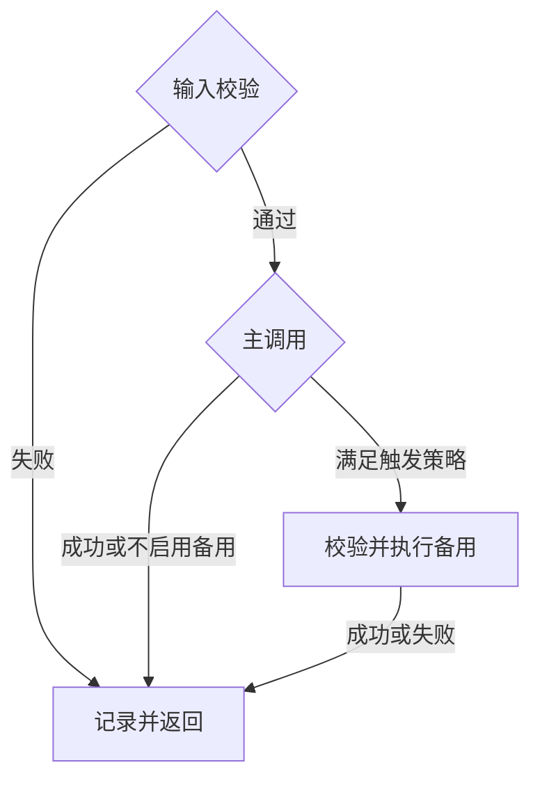

这是 PromptWeave 系列第 3 篇。上一篇说明了一次请求如何选中 Prompt 和模型。本篇处理最容易被临时补丁破坏的部分：**主调用失败后，系统应该怎样恢复？**

本篇仍然讨论架构设计，不代表 fallback 已经在生产环境上线。

假设数学题请求选中了 `Prompt A@v3 + Model A`。模型上游返回可重试错误。工程师最容易想到的办法是“换一个模型再试一次”，但这个动作没有回答三个问题：换的是哪份 Prompt？新模型的输入格式验证过吗？这次组合是否属于当前发布版本？

如果答案都是“运行时再决定”，系统虽然可能暂时返回结果，却无法证明备用路径是安全的。

## fallback 不是另一个模型名

备用路径应该在发布时绑定完整版本：

```text
main:     Prompt A@v3 + Model A
fallback: Prompt A-backup@v2 + Model A-backup
```

绑定关系至少需要包含备用 Prompt revision、ModelConfig revision 和触发策略。触发策略规定哪些错误可以进入备用路径、最多尝试几次，以及已经输出部分流式内容时是否允许切换。

fallback 不一定要改 Prompt；它至少要绑定确定的 Prompt revision、ModelConfig 和触发策略。这里使用独立的 backup Prompt，只是为了展示最完整的绑定关系。

这条规则很窄，但它解决了最严重的问题：**主调用失败时，系统只能进入已经被当前发布版本允许的路径。**不允许静默替换 Provider、模型或 Prompt。

一个逻辑请求和它的模型尝试应当分开记录：

```text
runId
├── attempt 1: main Prompt A@v3 + Model A
└── attempt 2: fallback Prompt A-backup@v2 + Model A-backup
```

调用方看到的是一次请求；系统在同一个 `runId` 下按顺序保留两次并列尝试。这样报表既能回答“这个场景最终成功率是多少”，也能回答“备用调用消耗了多少 token”。

## 校验必须发生在模型请求之前

Prompt revision 声明变量和输入格式。运行时先检查必填项、类型、空值和素材格式，再渲染模板；变量使用 `{{name}}`，不会扫描任意 `{...}`，避免误判 JSON、LaTeX 或自然语言。



输入校验失败不能进入模型调用，更不能进入 fallback。否则备用路径只是把同一个坏输入再发送一次。

## runId 让失败可以被解释

每次执行至少记录：

- 使用的 ReleaseSnapshot、Prompt revision 和 ModelConfig revision；
- 匹配的规则、分桶结果和路由决定；
- 每次尝试的触发原因、错误类别、耗时和 token；
- 最终结果，以及是否由 fallback 返回。

调试页面也调用同一套执行引擎，只额外标记 `runType=debug`。这样调试结果和真实请求使用同一套选择与校验逻辑，不会出现“调试能跑、线上走另一条路径”。

这套记录不是为了把日志做得更复杂，而是为了让一次失败具备可回答性：失败发生在选择、输入校验、主调用还是备用调用？当时使用的配置是否属于已发布快照？

下一篇会把这条执行链交付到测试和生产：**为什么发布与回滚必须以完整快照为单位，而不是分别改几个字段？**

上一篇：[PromptCode、ModelConfig 与路由：一次请求谁决定什么](/learn/promptweave/promptweave-routing-boundaries/) · 下一篇：[为什么发布和回滚必须以完整快照为单位](/learn/promptweave/promptweave-release-snapshots/)
