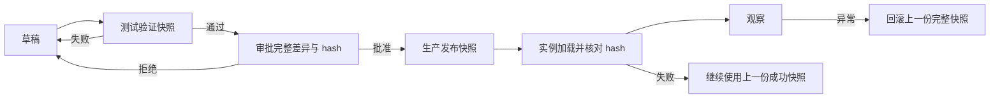

这是 PromptWeave 系列第 4 篇。前面三篇分别划定了配置边界、请求选择和 fallback 路径。本篇把它们放进一次真正的交付流程：**怎样把测试过的执行链送到生产，并在出问题时完整恢复。**

本篇仍然讨论架构设计，不代表这些发布能力已经在生产环境上线。下面是一个设计场景，用来检验发布和回滚边界。

一个解题产品正在测试两套方案：A 和 B 各获得一半流量。B 的效果更好，团队准备停止实验，让 B 全量运行。但 B 同时包含自己的 Prompt revision、模型配置、backup 和实验规则。只把默认 Prompt 改成 B，并不能证明生产会执行测试过的完整方案。

## 先创建新版本，不要覆盖旧版本

实验结束时，不能原地修改 `r1`：

```text
r1：A@v3 50% / B@v2 50%
r2：默认方案改为 B@v2，原实验规则 inactive
```

如果覆盖 `r1`，实验时的分流比例和备用关系就无法可靠复现；回滚也只能重新拼配置。新建 `r2` 会保留更多历史，但换来三个确定性：

- 测试过的版本不会被后续编辑改变；
- 发布差异可以明确审查；
- 回滚可以指向一个已知的完整版本。

Prompt 的历史也不应直接删除。被新的 Scenario release 替换后先标记 `superseded`；如果仍有受保护的 `promptCode` 直调，只阻止它进入 `archived`，不改变 `superseded` 状态。没有活动 Scenario 引用、没有受保护直调且过了保留期后，才进入 `archived`。归档任务要记录检查过的引用和跳过原因，历史版本不能被删除。

## 快照为什么是发布单位

测试和生产需要隔离执行实例、凭据、缓存和请求数据，但不应该各自维护一套无法比较的配置。配置管理库保存草稿、不可变版本、审批记录，以及两个环境各自的发布指针：

```text
配置管理库
├── Test 指针 → ReleaseSnapshot T
└── Production 指针 → ReleaseSnapshot P

Test 执行实例       Production 执行实例
```

一个 `ReleaseSnapshot` 至少固定：

- Prompt revisions；
- ModelConfig revisions；
- RouterRule revisions；
- fallback chain revisions；
- 内容 hash 和审批记录。

这解决了“测试环境改过什么、生产现在是什么”的比较问题。测试和生产比较的是完整快照与 hash，而不是两套数据库里当前看起来相似的字段。

**测试通过、审批通过和实例加载成功是三个不同状态。只有生产实例加载了获批的同一份快照，才进入观察阶段。**

## 发布时要验证哪几个状态

1. **测试验证。** 缺少变量、主调用失败或 fallback 不符合预期时，退回草稿修改。
2. **审批快照。** 发布申请附上完整差异、发布原因、操作者和 hash；审批后任何内容变化都必须重新审批。
3. **核对加载。** 生产实例加载快照后报告实际 hash。加载失败时继续使用上一份成功加载的快照，不能把“发布命令执行成功”当成上线成功。
4. **观察或恢复。** 指标正常就继续观察；出现异常时切换回上一份完整快照，再核对新请求实际使用的版本。

本例回滚到 `r1`，恢复的是 A/B 各 50% 的完整方案。如果目标是恢复 A 全量，需要选择另一份已经验证过的快照；不能靠手工把几个字段改回去。

## 快照如何保护一次请求



快照的价值不是把配置对象打包得更大，而是给发布、运行、审计和回滚提供同一个参照物。一次请求可以通过 `runId` 找回它使用的快照、场景、Prompt、模型、路由决定和每次 fallback 尝试。

## 这套设计的边界

第一阶段只证明可靠的直接执行：Prompt revision、ModelConfig、受限路由、一个显式 fallback、环境快照、审批 hash、加载核对和完整回滚。

第二阶段再增加 `scenarioCode`、实验、自动退休、确定性 PromptConf 编译、Dataset、A/B 评估和 MetaPrompt。动态健康路由、DAG、LCA 和自动晋级仍然是后续评估方向，不是第一阶段的隐式依赖。

回到开头的切换：只改 Prompt，无法证明 B 的完整路径经过了测试；把 Prompt、模型、fallback 和规则固定进不可变快照，测试、生产和回滚就能指向同一套配置。**读者最终得到的判断方法是：凡是会共同改变运行结果的配置，就应该一起验证、一起发布，并能作为整体恢复。**

上一篇：[主调用失败后，怎样进入一条可信的备用路径](/learn/promptweave/promptweave-fallback-observability/)
