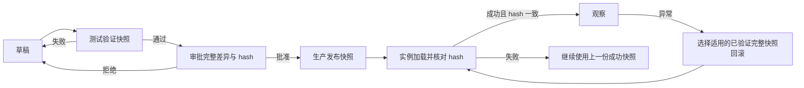

> **系列导读 · PromptWeave 第 4 篇**
>
> 前三篇讨论配置边界、请求选择与备用路径。本篇接着说明：测试过的一套配置，怎样原样发布，又怎样在出问题时恢复？
{: .prompt-info }

假设一个解题产品正在做 A/B 实验：A、B 是两套方案，各接收一半请求。团队已有充分依据认为 B 的效果更好，准备让 B 全量运行。最直接的想法是换掉默认 Prompt，但如果模型参数、路由或备用方案仍停在旧版，实际运行的就不再是测试过的那套 B。

**凡是会共同改变运行结果的配置，就应该一起验证、一起发布，并能作为整体恢复。**

本文讨论架构设计，尚不代表这些能力已经在生产上线。以下用同一个假设场景推导完整快照，并在发布、恢复和更换恢复目标三个节点提供可操作的模拟。可以先预测结果，也可以直接阅读后面的解释。

## 先认清：版本、快照和发布分别是什么

一份 Prompt 有自己的版本，模型配置也有自己的版本；一次发布则需要确定它们怎样组合。三个层次分别记录单个对象、完整组合和环境的期望状态。

| 名词 | 在本文中做什么 | 一个例子 |
| --- | --- | --- |
| revision（修订版本） | 固定某个配置对象的一次内容 | 某份 Prompt 的第 3 版 |
| ReleaseSnapshot（发布快照） | 固定一次发布所需的整套配置及其版本引用 | Prompt、模型配置、路由规则和备用链共同组成的 `r1` |
| 发布指针 | 记录某个环境应使用哪份快照 | Production 指向 `r1` |
| hash（内容摘要） | 用内容算出的标识，核对快照是否一致 | 测试、审批和实例报告的摘要一致 |
| 回滚 | 将运行配置恢复到一份选定的、适用的已验证快照 | 从 `r2` 切回 `r1`，再核对实际加载 |

这些名字是本文设计中的对象约定。ModelConfig 管模型与调用参数，RouterRule 管方案选择，fallback chain 是主调用失败后的备用路径。快照把这些配置的确定版本关联起来，不保存模型回答。

**快照固定配置组合，发布指针记录期望，实例报告实际加载的版本。三者有关联，但不能相互替代。**

指针改了，实例可能还没加载成功。hash 相同能帮助核对内容，却不能证明内容正确，也不能替代审批记录。

## 为什么不能只换 Prompt

回到 B 全量的场景。既然 B 已经测过，为什么不能直接换成 B 的 Prompt？关键在于：测试时，究竟有哪些配置共同参与了执行。


_配图：gpt-image-2。两张图连续阅读，按气泡从上到下的顺序跟随讨论。_

模型参数、路由规则和备用链也会改变运行结果。只替换 Prompt，可能拼出一套从未一起验证过的组合。因此，准备发布的完整组合需要固定下来，并一起验证。

在这套设计里，一个 `ReleaseSnapshot` 固定 Prompt revisions、ModelConfig revisions、RouterRule revisions、fallback chain revisions，并关联内容 hash 与审批记录。快照固定这些配置的版本组合，不包含运行凭据、缓存和请求数据。

固定组合的作用是让测试、审批和运行能指向同一份内容，不能省掉测试。如果只是独立的一段文本，不依赖其他可变配置，单独记录其版本可能已经足够。

## 新建 r2，保留 r1：为什么不能直接改旧版

把当前实验记为 `r1`，准备发布的 B 全量方案记为 `r2`：

```text
r1：A@v3 50% / B@v2 50%
r2：默认方案为 B@v2，原实验规则 inactive
```

`A@v3`、`B@v2` 表示方案及其固定版本，每套方案关联确定的 Prompt、模型和备用链；`r1`、`r2` 再固定如何选择它们。`inactive` 表示原实验规则不再参与选择。

如果直接把 `r1` 的比例改掉，历史请求记录里的“使用 r1”就无法说明当时究竟运行了哪套配置。因此，草稿可以修改，已经固定的版本不能原地覆盖。新方案另建 `r2`，测试记录、审批差异和历史请求仍能准确指回各自的配置。

保留历史也不意味着永远允许新请求选择它。停用、归档和删除是不同操作。

<details markdown="1">
<summary>维护历史：替代与归档的条件</summary>

Scenario release 表示某个调用场景的发布版本，`promptCode` 是调用方可能直接使用的 Prompt 标识。相关对象边界见本系列前文。

Prompt 被新的 Scenario release 替换后，先标记为 `superseded`（已被替代）。如果仍存在受保护的 `promptCode` 直调，只阻止它进入 `archived`（归档），不把它改回未被替代的状态。

没有活动 Scenario 引用、没有受保护直调，而且已过保留期，才能归档。归档任务记录检查过的引用和跳过原因，历史版本不能被删除。

</details>

## 测试和生产：配置一致，执行环境隔离

测试和生产要对照的是获批配置的内容，不能为了“一致”而共用执行实例、凭据、缓存或请求数据。否则测试请求可能影响生产。

```text
配置管理库
├── Test 指针 → ReleaseSnapshot T
└── Production 指针 → ReleaseSnapshot P

Test 执行实例       Production 执行实例
（凭据、缓存、请求数据分别隔离）
```

配置管理库保存草稿、不可变版本和审批记录，分别维护环境指针。测试可以先加载候选快照，生产继续使用旧快照；验证和审批完成后，生产再加载同一份获批内容。最终仍要核对实例实际加载的版本与 hash。

## 发布：测试通过后，还需要审批与加载核对

提交 `r2` 前，测试既要覆盖正常回答，也要覆盖变量缺失、主调用失败和备用路径。

测试是否通过取决于预期：正常用例出现非预期失败，应退回草稿；主动注入故障时，备用路径按预期执行，才算通过对应恢复测试。不能只检查最后有没有返回文字。

测试通过后，发布申请附上完整差异、发布原因、操作者和快照 hash。审批后即使只改一个错字，也改变了内容，需要重新审批，不能继续拿旧记录证明新内容获批。

现在假设测试、审批都已完成，发布指针也已更新，但实例加载失败。新请求会使用哪套配置？

<iframe src="/labs/release-snapshots/?scene=release&embed=1" title="发布指针与实际加载" width="100%" height="900" loading="lazy" style="border: 0;"></iframe>

[单独打开：发布指针与实际加载](/labs/release-snapshots/?scene=release)

<noscript>互动需要 JavaScript，下文保留完整解释。</noscript>


_配图：gpt-image-2。两张图连续阅读，按气泡从上到下的顺序跟随讨论。_

加载失败时，实例继续使用上一份成功加载的快照。加载成功后，还要核对实例报告的完整 hash 是否与获批内容一致，再进入观察阶段，从新请求核对实际使用的版本。即使指针和实例版本碰巧相同，也不能仅凭这一点断言本次加载成功。

**测试通过、审批通过和实例加载成功是三个不同状态。只有生产实例加载了获批的同一份快照，才进入观察阶段。**

## 出现异常：先确定恢复目标，再选版本

假设生产已成功加载 B 全量的 `r2`，随后出现异常，目标是让新请求不再走 B。离当前最近的旧版本是 `r1`，但它是否符合这个目标，需要查快照内容，而不是看版本新旧。

在下面的模拟中选择一个候选，预测加载尝试后的分流比例，再检查是否达到目标。

<iframe src="/labs/release-snapshots/?scene=rollback&embed=1" title="选择能达到目标的恢复快照" width="100%" height="900" loading="lazy" style="border: 0;"></iframe>

[单独打开：选择能达到目标的恢复快照](/labs/release-snapshots/?scene=rollback)

<noscript>互动需要 JavaScript，下文保留完整解释。</noscript>


_配图：gpt-image-2。两张图连续阅读，按气泡从上到下的顺序跟随讨论。_

`r1` 记录的是 A/B 各一半。恢复它能重建原来的实验组合，却不能让 B 的流量变成零。回滚不会根据故障原因自动删除快照中的 B，也不会把“恢复旧状态”变成“恢复现在想要的状态”。

如果目标是 A 全量，就需要一份已验证、适用于当前故障条件的 A 全量快照，例如本例中的 `r0`。没有这样的候选时，不能现场拼几个字段，冒充已经验证过的恢复方案。

以前运行过的版本也需要重新检查适用性：当前故障可能同样影响它。切换后还要核对加载结果、实例 hash 与新请求版本。快照恢复只改变执行配置，不备份用户数据，也不会撤销已经完成的请求或其他既有结果。

## 把整条路径接起来，再换一个目标



加载失败与接管后的异常是两种不同状态：前者保留上一份成功配置，后者需要按恢复目标重新选择适用快照。排查单次请求时，通过 `runId` 找回它使用的快照、场景、Prompt、模型、路由决定和每次备用调用尝试。

现在换一个目标：实例已运行 A 全量的 `r0`，需要恢复 A/B 各一半的实验。本题假设候选都已验证、获批且适用于当前环境。候选应怎么选？加载失败又会怎样？

<iframe src="/labs/release-snapshots/?scene=transfer&embed=1" title="换个目标：恢复实验" width="100%" height="900" loading="lazy" style="border: 0;"></iframe>

[单独打开：换个目标，恢复实验](/labs/release-snapshots/?scene=transfer)

<noscript>互动需要 JavaScript，可展开下方解释。</noscript>

<details markdown="1">
<summary>先作判断，再查看解释</summary>

恢复实验的候选是 `r1`，因为它记录 A/B 各半；停用 B 才需要 A 全量的 `r0`。如果 `r1` 加载失败，实例仍运行 `r0`，实验没有恢复。

真实操作中，先确认候选在当前环境适用，再核对加载结果、实例完整 hash 和新请求版本。

</details>

**回滚恢复的是选定快照记录的完整配置。先明确要恢复什么，再选择适用的版本，最后验证实例和新请求确实使用了它。**

试着解释：同样选了 `r1`，为什么有时达到了目标，有时没有？答案需要同时包含恢复目标与加载结果。

## 这套设计先做到哪里

上面的 A/B 场景用于检验设计边界，不代表第一阶段就要实现整个实验平台。

第一阶段先验证从直接调用到发布、回滚的完整链路：Prompt revision、ModelConfig、受限路由、一个显式 fallback、环境快照、审批 hash、加载核对和完整回滚。

<details markdown="1">
<summary>对照完整方案：后续阶段范围</summary>

第二阶段再增加 `scenarioCode`（场景标识）、实验、自动退休、确定性 PromptConf 编译、Dataset（评估数据集）、A/B 评估和 MetaPrompt（用于生成或改进 Prompt 的提示）。动态健康路由、DAG、LCA 和自动晋级仍属于后续评估方向，不是第一阶段的隐式依赖；理解本篇不需要先掌握这些扩展。

</details>

上一篇：[主调用失败后，怎样进入一条可信的备用路径](/learn/promptweave/promptweave-fallback-observability/)
