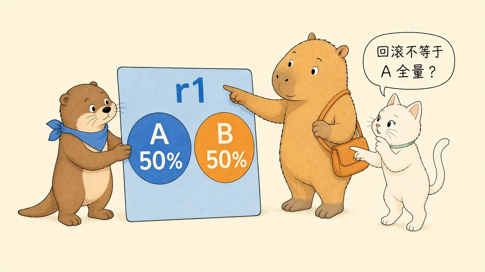
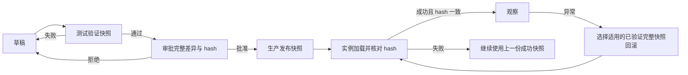

这是 PromptWeave 系列第 4 篇。前面分别讨论了配置边界、请求选择和备用路径；这里接着回答：测试过的一套配置，怎样原样发布，又怎样在出问题时恢复？

本文讨论的是架构设计，尚不代表这些能力已经在生产环境上线。水豚学长、水獭大师兄和白猫小师妹将围绕一个假设场景，把这条链路走一遍。

## 先认清：版本、快照和发布分别是什么

**白猫：**“我知道 Prompt 是给模型的指令。但 revision、snapshot 和发布指针是什么关系，为什么要分这么多名字？”

**水豚：**“先分清我们给什么东西编号。一份 Prompt 可以有自己的版本，模型配置也可以有自己的版本；一次发布则要指定它们怎样组合。”

| 名词 | 在本文中做什么 | 一个例子 |
| --- | --- | --- |
| revision（修订版本） | 固定某个配置对象的一次内容 | 某份 Prompt 的第 3 版 |
| ReleaseSnapshot（发布快照） | 固定一次发布所需的整套配置及其版本引用 | Prompt、模型配置、路由规则和备用链共同组成的 `r1` |
| 发布指针 | 记录某个环境应使用哪份快照 | Production 指向 `r1` |
| hash（内容摘要） | 用内容算出的标识，核对快照是否一致 | 测试、审批和实例报告的摘要一致 |
| 回滚 | 将运行配置恢复到一份选定的、适用的已验证快照 | 从 `r2` 切回 `r1`，再核对实际加载 |

这些名字是本文设计中的对象约定。前文的 ModelConfig 管模型与调用参数，RouterRule 管方案选择；fallback chain 是主调用失败后采用的备用路径。快照把这些配置的确定版本关联起来，不是另存一份模型回答。

**水獭：**“也就是说，revision 解决‘单个对象是哪版’，快照解决‘哪些版本配成一套’，发布指针解决‘环境准备使用哪套’。”

**白猫：**“那指针已经改了，实例就一定用上新配置了吗？”

**水豚：**“不一定。指针表达期望，实例还得加载。后面我们会专门检查这一步。hash 也只能帮助核对内容，不能证明内容本身正确或已经获批。”

**一份发布快照固定的是配置组合；环境指针和实例实际加载的版本，是需要分别核对的状态。**

## 什么时候需要它：B 测试通过，为什么不能只换 Prompt

假设一个解题产品在做 A/B 实验：A、B 是两套方案，各接收一半请求。团队认为 B 的效果更好，准备让 B 全量运行。这里假定实验结论已具备相应依据，不讨论怎样评价效果。

**白猫：**“那把默认 Prompt 换成 B 就好了？”

**水獭：**“我会先对照 B 测试时用的模型参数和备用方案。如果这些配置变了，运行的就不一定还是测试过的 B。”

**水豚：**“你们关注的是两件事：白猫想切换入口，水獭想保留测试过的执行路径。想证明发布的是同一套方案，就得先确定哪些配置共同影响结果。”


_配图：gpt-image-2。盒子表示共同固定的配置版本，不包括运行凭据、缓存和请求数据。_

在这套设计里，一个 `ReleaseSnapshot` 至少固定 Prompt revisions、ModelConfig revisions、RouterRule revisions、fallback chain revisions，并关联内容 hash 与审批记录。

**白猫：**“像按整张菜谱备料？主料换了，调料和做法却留在另一道菜，就不能说做的是原来那道菜。”

**水豚：**“这个类比能说明配置之间的关系。但配置配齐了，仍不等于效果有保证。我们固定组合，是为了能验证和复现它，不是省掉测试。”

**凡是会共同改变运行结果的配置，就应该一起验证、一起发布，并能作为整体恢复。**

如果只有一段不依赖其他配置的简单文本，单独记录其版本可能已经足够。这里需要快照，是因为实际执行同时依赖多个可变对象。

## 先做一个新版本：为什么不能直接修改 r1

水獭把当前实验记成 `r1`，把准备发布的方案记成 `r2`：

```text
r1：A@v3 50% / B@v2 50%
r2：默认方案为 B@v2，原实验规则 inactive
```

这里 `A@v3`、`B@v2` 表示方案及其固定版本：每套方案关联确定的 Prompt、模型和备用链，`r1`、`r2` 再固定如何选择它们；`inactive` 表示原实验规则不再参与选择。

**白猫：**“既然不做实验了，直接把 `r1` 里的比例改掉，不是更省事吗？”

**水獭：**“那以后查到‘当时用的是 r1’，还知道它当时是各一半，还是 B 全量吗？”

**水豚：**“这就是保留旧版本的原因。草稿可以改，已经固定的版本不原地覆盖。我们创建 `r2`，让测试记录、审批差异和历史请求仍能准确指回各自的配置。”


_配图：gpt-image-2。保留旧记录，新方案另建版本。_

旧版本保留不等于永远允许新请求选择它。停用、归档与删除是不同操作。

<details markdown="1">
<summary>需要维护历史时：替代与归档的条件</summary>

这里的 Scenario release 表示某个调用场景的发布版本，`promptCode` 是调用方可能直接使用的 Prompt 标识。相关对象边界见本系列前文。

Prompt 被新的 Scenario release 替换后，先标记为 `superseded`（已被替代）。如果仍存在受保护的 `promptCode` 直调，只阻止它进入 `archived`（归档），不把它改回未被替代的状态。

没有活动 Scenario 引用、没有受保护直调，而且已过保留期，才能归档。归档任务记录检查过的引用和跳过原因，历史版本不能被删除。

</details>

## 测试和生产：用同一份配置，不等于共用环境

**白猫：**“要让测试和生产一致，是不是干脆让它们共用一个库、一个运行环境？”

**水獭：**“这样测试请求可能碰到生产数据。我希望配置能对照，但执行实例、凭据、缓存和请求数据要隔离。”

**水豚：**“对，我们要一致的是获批配置的内容，不是把两个环境混在一起。配置管理库保存草稿、不可变版本和审批记录，再分别维护环境的发布指针。”

```text
配置管理库
├── Test 指针 → ReleaseSnapshot T
└── Production 指针 → ReleaseSnapshot P

Test 执行实例       Production 执行实例
（凭据、缓存、请求数据分别隔离）
```

**白猫：**“测试可以先加载候选快照，生产继续用旧快照；等验证和审批完成，再让生产加载同一份获批内容？”

**水豚：**“是的。比较完整快照和 hash，比检查两套库里的几个字段‘看起来差不多’更可靠。但最终仍要问实例实际加载了什么。”

## 发布：测试通过以后，还缺哪两次确认

**水獭：**“我准备提交 `r2`。测试除了看正常回答，还要检查变量缺失、主调用失败以及备用路径是否符合预期。”

**白猫：**“主调用失败，测试就算失败吗？”

**水豚：**“先看测试目的。正常用例里出现非预期失败，要退回草稿；如果这次就是主动注入故障，预期的备用路径正确执行，才算通过对应恢复测试。不能只看‘最后有没有返回文字’。”

测试通过后，水獭把完整差异、发布原因、操作者和快照 hash 放进发布申请。

**白猫：**“审批之后发现一个错字，顺手改掉可以吗？”

**水獭：**“改了内容，就不是原来获批的快照了。我会重新走审批，不能继续拿旧记录证明它被批准过。”

**水豚：**“再往前一步：即使审批通过、发布命令也成功，生产实例加载失败了呢？”


_配图：gpt-image-2。H1 是摘要的示意写法；实际需核对完整 hash，三种状态互不替代。_

**白猫：**“就要看实例报告的实际 hash。它得和获批快照一致，不能只看发布指针。”

**水獭：**“加载失败时继续用上一份成功加载的快照；加载成功后进入观察，再从新请求核对实际使用的版本。”

**测试通过、审批通过和实例加载成功是三个不同状态。只有生产实例加载了获批的同一份快照，才进入观察阶段。**

## 出现异常：回到旧版本，就没有 B 了吗

现在假设生产已成功加载 B 全量的 `r2`，随后发现异常。白猫想让新请求不再走 B，水獭准备查看恢复方案。

**白猫：**“退回旧版本 `r1`，是不是就回到 A 全量了？”

**水獭：**“我也倾向先查以前运行过的版本，但得看记录。‘旧’不说明它里面是什么。”

**水豚：**“你们想做到的是恢复旧状态，还是停用 B？先分清目标，再判断 `r1` 是否合适。”

先猜一下：`r1` 恢复后，新请求是走 A 全量，还是 A/B 各一半？


_配图：gpt-image-2。分流比例来自本例的版本记录。_

**白猫：**“是各一半。我把‘回到旧版本’想成‘停用 B’了，但那时已经有 B。”

**水獭：**“那我们刚才考虑的目标不同。我想恢复以前的组合，你想让 B 的流量变成零。回到 `r1` 只满足前一个目标。”

**水豚：**“还要检查这次的故障条件是否也影响 `r1`。以前运行过，不等于现在一定安全。回滚按快照记录恢复，不会根据故障原因自动删掉其中的 B。”

**白猫：**“像恢复手机备份：恢复的是那天记录的样子，不是我现在心里想要的样子。”

**水豚：**“这能说明恢复目标的区别。但我们的快照只固定执行配置，不备份用户数据，也不会撤销已经发生的请求结果。”

**水獭：**“如果要 A 全量，就另找一份已验证、适用于当前故障条件的 A 全量快照。没有这样的版本，就不能现场拼几个字段，冒充已经验证过的恢复方案。”

**白猫：**“切换后也要查实际 hash 和新请求版本。回滚命令执行成功，还不够。”

## 把整条路径接起来，再自己判断一次



**水獭：**“加载失败时，新配置还没接管，继续保留上一份成功快照；已经加载后发现异常，才需要按恢复目标重新选快照。这两种失败不能混为一谈。”

**水豚：**“之后排查一条请求，可以通过它的 `runId` 找回使用的快照、场景、Prompt、模型、路由决定和每次备用调用尝试。版本记录让这些判断有据可查。”

现在换个情境：`r0` 是已验证的 A 全量，`r1` 是 A/B 各一半，`r2` 是 B 全量。当前运行 `r2`，目标是让新请求不再走 B。你会先检查哪个候选版本？选定后还要验证什么？

<details markdown="1">
<summary>先作判断，再对照两位伙伴的答案</summary>

**白猫：**“先检查 `r0` 是否仍然适用，因为它记录的才是 A 全量。不能只因为 `r1` 离现在更近就选它。”

**水獭：**“再核对实例加载的 hash 和新请求使用的版本。如果目标改成恢复原来的 A/B 实验，候选才是 `r1`，同样要检查当前适用性。”

</details>

**回滚恢复的是选定快照记录的完整配置。先明确要恢复什么，再选择适用的版本，最后验证实例和新请求确实使用了它。**

## 这套设计先做到哪里

**白猫：**“是不是要把实验、评估、自动切换全做好，这条链路才能开始用？”

**水豚：**“不用。上面的 A/B 场景是拿来检验设计边界，不代表第一阶段就要实现整个实验平台。”

第一阶段先验证从直接调用到发布、回滚的完整链路：Prompt revision、ModelConfig、受限路由、一个显式 fallback、环境快照、审批 hash、加载核对和完整回滚。

<details markdown="1">
<summary>需要对照完整方案时：后续阶段范围</summary>

第二阶段再增加 `scenarioCode`（场景标识）、实验、自动退休、确定性 PromptConf 编译、Dataset（评估数据集）、A/B 评估和 MetaPrompt（用于生成或改进 Prompt 的提示）。动态健康路由、DAG、LCA 和自动晋级仍属于后续评估方向，不是第一阶段的隐式依赖；理解本篇不需要先掌握这些扩展。

</details>

上一篇：[主调用失败后，怎样进入一条可信的备用路径](/learn/promptweave/promptweave-fallback-observability/)
