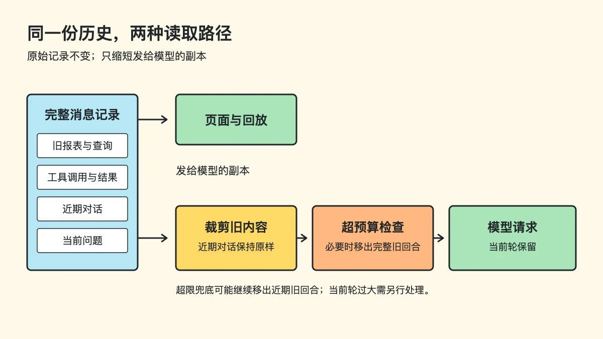

一些长上下文模型已经有 1M token 级别的窗口。做多轮 Agent 时，这仍不是一张可以无限刷的卡：用户会不断追问，工具会不断返回结果，每一轮都带着全部历史重新请求，成本和请求体也跟着增长。

以一个假设的订单分析助手为例。用户先问上个月的销售额，又贴来一份长报表，让它按渠道比较、查退货。十几轮后，用户刚和助手确认退货率的统计口径，接着问：“为什么上升？”助手需要刚确认的口径和最近的查询结果，却未必需要重新读完之前每一份报表。

问题是：**该从哪里缩短历史，才不让下一轮回答失去依据？**

## 两种常见的触发方式

一种是**固定水位**：先给活跃上下文设一个容量阈值，例如达到窗口预算的某个比例后，就把较早的一段对话压成摘要，同时保留最近几轮原文。比例只是示意，实际还得为下一轮工具结果和模型输出留空间。它的好处是处理时机明确；代价是接近水位的那一轮可能一下改变很长的请求前缀。

另一种是**动态滚动**：随着新回合进入，持续调整保留区。最简单的是只留最近若干轮；更稳妥的是按实际体积保留，再把旧段摘要化或移出。它能持续控制请求大小，但如果每轮都改旧前缀，prompt cache 也可能每轮失效。

| 方式 | 什么时候调整 | 最容易遇到的问题 |
| --- | --- | --- |
| 固定水位 | 活跃上下文达到预设占用量 | 水位过高时，下一轮的大工具结果仍可能冲破预算 |
| 动态滚动 | 新回合不断进入，保留区随之移动 | 按消息条数裁切不准；频繁改前缀可能伤缓存 |

这两个名字描述的是**触发时机**。触发之后，可以裁短旧工具结果，也可以把旧对话写成摘要；单看“固定水位”或“动态滚动”，还不知道具体会保留什么。

## 攒够一批再裁剪，发送前检查大小

**等旧内容攒到一次值得裁剪的量，才推进截断点；如果发送前仍然超限，再移走最旧的完整回合。**

这是以可节省量为门槛的批量处理，和前面按窗口占用触发的固定水位不同。

这里要分开三种计量：模型窗口与缓存按 token 计算，旧内容按字符数裁短，而裁剪收益和接口请求体上限按序列化后的字节数判断。

还是刚才的订单分析。早期工具输出累计有几万字，对话已经推进到新的退货口径。一次回合结束后，系统找到一个安全切点：最多切到倒数第 6 次用户发言之前；如果这批旧内容按规则裁剪能省下至少 **120,000 字节**，就保存切点，从下一轮开始使用。

切点之前，普通工具输出只留前 **80 字**；用户粘贴的长文本超过 **2,000 字**时只留前 **500 字**。向用户提问的工具输出不裁。切点之后的消息保持原样。找不到不拆散工具调用与结果的切点，这一轮就不推进。这些阈值是这个实现的参数，不能直接当作其他 Agent 的推荐配置。

这会让部分旧内容暂时多占空间。截断点推进时，旧消息一变，改动处之后的缓存通常也无法复用；但截断点不必每轮变化，后续几轮又能沿用新的稳定前缀。**批量裁剪省下一大块内容时，才值得付出一次缓存失效的代价。**

## 历史留下，发送副本变短

**完整对话留在原始记录里；裁剪和丢弃只发生在这一轮发给模型的副本中。**

以虚构的 demo 表为例，`demo_messages` 按 `seq` 留下用户消息、助手回复和工具交互，`demo_sessions` 只保存截断点 `trimBeforeSeq`。页面回看和故障复盘继续读完整记录；给模型的消息则从这些记录临时组装。

例如，“查退货率”的工具调用和结果分别是 `seq=12`、`seq=13`。原结果留在 `demo_messages`；当它位于截断点之前时，发给模型的副本只取结果开头。切点使用持久化的 `seq`，重连后也能对准同一条消息；临时生成、没有 `seq` 的消息不参与裁剪。

每次发送前，系统先按截断点生成副本，再计算消息和工具定义的 JSON 字节数。若仍超过 **900,000 字节**，就从最早的完整回合开始移出，直到进入预算。一次提问、其中的工具调用与结果、助手回复要一起处理，不能只留下半段工具交互。

这道预算线来自接收接口约 **1 MiB** 的请求体上限，并为外层字段留出余量。为什么裁剪后还会超限？最近的几轮和本轮输入也可能很大。极端情况下，系统会把最近 6 轮中的旧回合继续移出，**只保证当前正在处理的一轮不丢**。若当前轮自身就超预算，应返回明确错误或由上层缩小输入；删旧历史也救不了它。

发送前的裁剪和超限检查不额外调用模型。截断点写库失败时，本进程暂用新值并在后续保存时重试；换一个进程可能暂时读到旧值，但每次发送前仍独立检查请求大小。

## 什么时候才需要摘要

前两层按位置与长度处理消息，并不理解哪条内容对后续最重要。如果关键口径落在被裁掉的旧段里，助手仍可能忘记它。只有这类损失在回放中真实出现，才值得考虑摘要快照：把更早的历史归纳成目标、约束和已确认结论，最近的对话继续保留原文。摘要要能与原始记录核对，生成失败或压完反而更长时不能采用。

**这一步目前只是候选设计，没有实施。** 是否需要引入摘要，可以先看两项证据：超限丢弃究竟发生了多少次；回放同一组长会话时，回答是否真的丢了必要背景。若前两层已经够用，新增一次摘要模型调用与快照维护只会增加系统复杂度。

## 怎么验收

用相同的长会话回放，对比每次请求的字节数、输入 token、缓存用量和后续回答。请求进了预算，只说明接口能接住它；还要检查助手是否继续遵守用户早先确认的口径。把这些结果放在一起，才能判断压缩省下的成本是否值得它带来的上下文损失。

## 参考资料

- [Gemini 长上下文说明](https://ai.google.dev/gemini-api/docs/long-context)：部分模型提供百万级或更大的窗口，具体容量与输入输出预算按模型区分。
- [Claude Compaction 概览](https://platform.claude.com/docs/en/build-with-claude/compaction)：介绍按需和达到 token 阈值后的摘要压缩，以及保留近期回合等做法。
- [Claude Context editing](https://platform.claude.com/docs/en/build-with-claude/context-editing)：说明清理旧工具结果时，为什么需要把节省量与 prompt cache 失效放在一起考虑。
